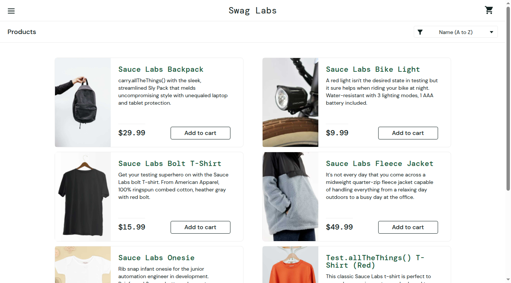
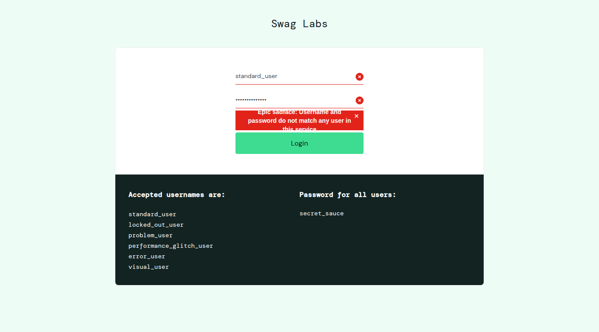
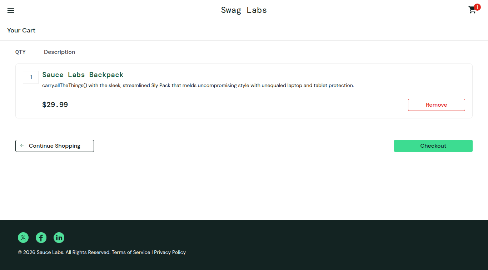
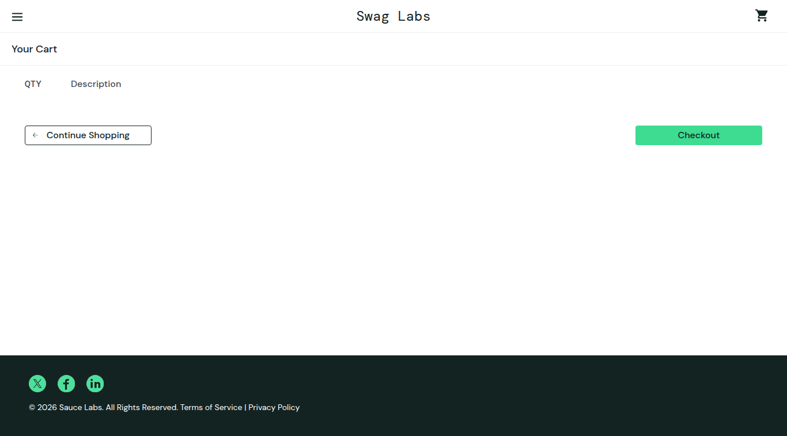
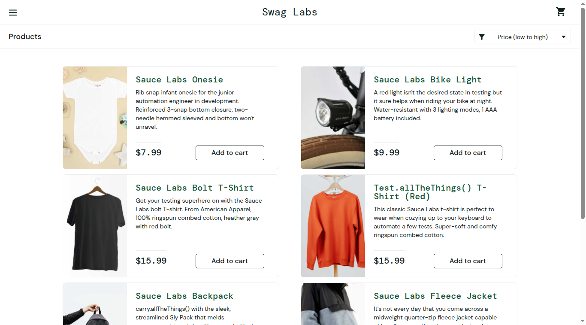
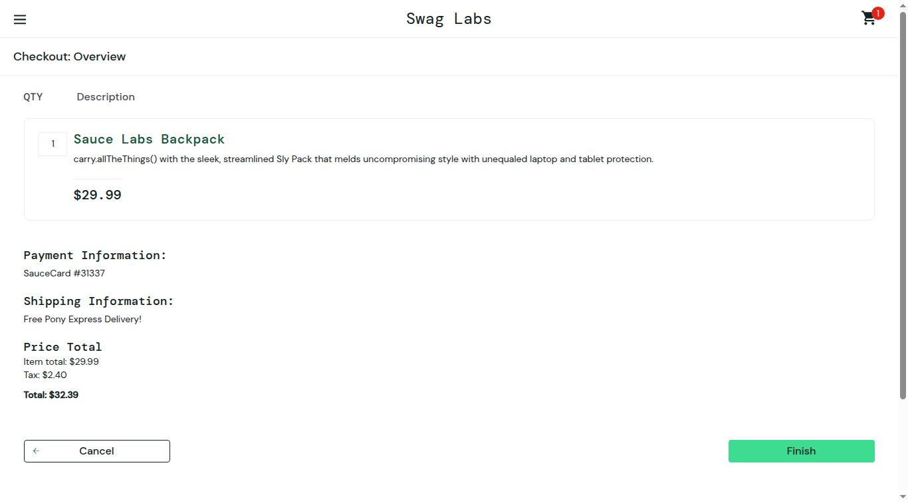
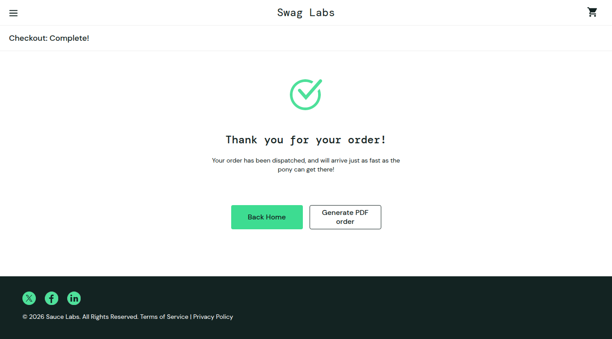
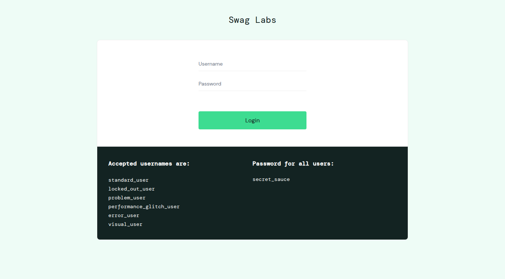

# Lab 9 — Kiểm thử tự động với Selenium WebDriver

Báo cáo Lab 9: học công cụ kiểm thử **Selenium** và xây dựng **06 test case** kiểm thử tự động (đề yêu cầu tối thiểu 05) cho website **SauceDemo (Swag Labs)** bằng Python + Selenium WebDriver + pytest.

## 1. Giới thiệu Selenium & kiến trúc WebDriver

**Selenium** là bộ công cụ mã nguồn mở phổ biến nhất cho kiểm thử tự động giao diện web. Thay vì kiểm thử viên bấm chuột tay, test script điều khiển một trình duyệt thật (Chrome/Firefox/Edge) y như người dùng: mở trang, nhập liệu, click, đọc nội dung — rồi tự khẳng định (assert) kết quả đúng/sai.

Kiến trúc của **Selenium WebDriver** (chuẩn W3C WebDriver):

```
Test script (Python + pytest)
        │  HTTP/JSON (W3C WebDriver protocol)
        ▼
ChromeDriver  ──►  Google Chrome (trình duyệt thật)
        ▲
Selenium Manager tự tải ChromeDriver khớp phiên bản Chrome
```

Các khái niệm đã áp dụng trong bài:

| Khái niệm | Cách dùng trong bài |
|---|---|
| **Locator** | Tìm phần tử bằng `By.ID`, `By.CLASS_NAME`, `By.CSS_SELECTOR` (ví dụ: `#user-name`, `.inventory_item`, `[data-test="error"]`) |
| **Explicit Wait** | `WebDriverWait` + `expected_conditions` chờ phần tử/URL sẵn sàng thay vì `sleep` cứng, giúp test ổn định |
| **Assertion** | Khẳng định URL, số lượng sản phẩm, badge giỏ hàng, thứ tự giá, thông báo lỗi, tổng tiền… |
| **Fixture (pytest)** | `conftest.py` khởi tạo/đóng WebDriver cho từng test, các test độc lập nhau |

## 2. Môi trường & công cụ đã dùng (số liệu thật)

| Hạng mục | Phiên bản / thông tin |
|---|---|
| Ngôn ngữ | Python 3.12.3 |
| Thư viện kiểm thử | Selenium 4.51.0 |
| Test runner | pytest 9.1.1 |
| Plugin báo cáo | pytest-html 4.2.0 |
| Trình duyệt | Google Chrome 156.0.8078.47 (chế độ headless) |
| Driver | ChromeDriver 156.0.8078.47 (Selenium Manager tự tải, khớp 100% với Chrome) |
| Hệ điều hành | Ubuntu 24.04 LTS (Linux VM) |
| Ngày chạy | 23/10/2026 |
| Website đích | https://www.saucedemo.com/ |

**Website đích:** SauceDemo ("Swag Labs") là website demo do Sauce Labs xây dựng chuyên cho học/thực hành automation testing — có đủ luồng đăng nhập, danh sách sản phẩm, giỏ hàng, checkout, đăng xuất. Tài khoản dưới đây **được công bố công khai ngay trên trang đăng nhập của chính website** (không phải tài khoản cá nhân):

| Tài khoản | Mật khẩu | Dùng cho |
|---|---|---|
| `standard_user` | `secret_sauce` | Luồng thành công |
| `locked_out_user` | `secret_sauce` | Trường hợp bị khoá (TC02) |

## 3. Danh sách test case & kết quả thực tế

| Mã | Test case | Mục tiêu & các bước chính | Kết quả mong đợi | Kết quả thực tế |
|---|---|---|---|---|
| TC01 | Đăng nhập thành công | Nhập `standard_user`/`secret_sauce` → Login | Vào trang `/inventory.html`, tiêu đề "Products", có 6 sản phẩm | ✅ **PASSED** |
| TC02 | Đăng nhập thất bại | (1) Sai mật khẩu; (2) đăng nhập bằng `locked_out_user` | Hiện lỗi "Username and password do not match…" / "…has been locked out", không vào được trang sản phẩm | ✅ **PASSED** |
| TC03 | Thêm sản phẩm vào giỏ | Đăng nhập → Add to cart "Sauce Labs Backpack" → mở giỏ | Badge giỏ hàng = 1; trong giỏ có đúng sản phẩm đã thêm ($29.99) | ✅ **PASSED** |
| TC04 | Xoá sản phẩm khỏi giỏ | Thêm sản phẩm → vào giỏ → Remove | Giỏ trống (0 sản phẩm), badge giỏ hàng biến mất | ✅ **PASSED** |
| TC05 | Sắp xếp theo giá tăng dần | Đăng nhập → chọn "Price (low to high)" | Giá hiển thị tăng dần: rẻ nhất $7.99 → đắt nhất $49.99 | ✅ **PASSED** |
| TC06 | Checkout hoàn chỉnh & đăng xuất | Thêm sản phẩm → Checkout → điền họ tên/mã bưu chính → Continue → kiểm tra tổng tiền → Finish → mở menu → Logout | Tổng tiền $32.39 ($29.99 + thuế $2.40); hiện "Thank you for your order!"; đăng xuất quay về trang đăng nhập | ✅ **PASSED** |

Mã nguồn test: [`tests/test_saucedemo.py`](tests/test_saucedemo.py) — mỗi hàm test tương ứng một TC, có assert rõ ràng.

## 4. Kết quả chạy thật

```
tests/test_saucedemo.py::test_tc01_login_success PASSED                  [ 16%]
tests/test_saucedemo.py::test_tc02_login_failure PASSED                  [ 33%]
tests/test_saucedemo.py::test_tc03_add_to_cart PASSED                    [ 50%]
tests/test_saucedemo.py::test_tc04_remove_from_cart PASSED               [ 66%]
tests/test_saucedemo.py::test_tc05_sort_by_price_low_to_high PASSED      [ 83%]
tests/test_saucedemo.py::test_tc06_checkout_complete_and_logout PASSED   [100%]

============================== 6 passed in 44.87s ==============================
```

- **Tổng số test: 6 — Passed: 6 — Failed: 0** (thời gian chạy: 44.87s, ngày 23/10/2026)
- Log đầy đủ: [`reports/test-results.txt`](reports/test-results.txt)
- Báo cáo HTML của pytest-html sinh ra khi chạy: `reports/report.html` (file này được tạo mỗi lần chạy, không commit lên repo — xem hướng dẫn chạy lại ở mục 6)

## 5. Hình ảnh kết quả

### TC01 — Đăng nhập thành công, vào trang danh sách sản phẩm



*Hình 1: Trang danh sách sản phẩm sau khi đăng nhập thành công.*

### TC02 — Đăng nhập thất bại: sai mật khẩu



*Hình 2: Thông báo lỗi khi nhập sai mật khẩu.*

### TC02 — Đăng nhập thất bại: tài khoản bị khoá


*Hình 3: Thông báo lỗi khi đăng nhập bằng tài khoản `locked_out_user`.*

### TC03 — Thêm sản phẩm vào giỏ hàng (badge = 1, sản phẩm có trong giỏ)



*Hình 4: Giỏ hàng sau khi thêm Sauce Labs Backpack, biểu tượng giỏ hàng hiển thị số 1.*

### TC04 — Xoá sản phẩm khỏi giỏ hàng (giỏ trống)



*Hình 5: Giỏ hàng sau khi bấm Remove, không còn sản phẩm nào.*

### TC05 — Sắp xếp sản phẩm theo giá tăng dần



*Hình 6: Danh sách sản phẩm khi chọn sắp xếp "Price (low to high)", sản phẩm rẻ nhất Sauce Labs Onesie $7.99 đứng đầu.*

### TC06 — Checkout: màn hình xác nhận đơn hàng (tổng $32.39)



*Hình 7: Màn hình Checkout Overview trước khi bấm Finish.*

### TC06 — Checkout hoàn tất: "Thank you for your order!"



*Hình 8: Màn hình thông báo đặt hàng thành công sau khi bấm Finish.*

### TC06 — Đăng xuất thành công, quay về trang đăng nhập



*Hình 9: Trang đăng nhập sau khi đăng xuất.*

## 6. Hướng dẫn cài đặt & chạy lại

Yêu cầu: máy có **Python 3.10+** và **Google Chrome** (Selenium Manager sẽ tự tải ChromeDriver khớp phiên bản Chrome, không cần cài driver thủ công).

```bash
# 1. Clone repo
git clone https://github.com/bachiep/lab9-selenium.git
cd lab9-selenium

# 2. Tạo môi trường ảo và cài thư viện
python3 -m venv venv
source venv/bin/activate        # Windows: venv\Scripts\activate
pip install -r requirements.txt

# 3. Chạy toàn bộ test (kèm log + báo cáo HTML)
python -m pytest tests/ -v --html=reports/report.html --self-contained-html

# Chạy một test case riêng lẻ, ví dụ TC03:
python -m pytest tests/test_saucedemo.py::test_tc03_add_to_cart -v
```

Sau khi chạy, kết quả hiển thị ở terminal và báo cáo HTML nằm tại `reports/report.html`.

> **Ghi chú môi trường (workaround thật đã áp dụng):** Lần chạy nộp bài được thực hiện trên VM Linux không màn hình (Chrome chạy `--headless=new`) và ra Internet qua egress proxy có xác thực + chứng chỉ MITM. Chrome không hỗ trợ nhúng `user:pass` vào `--proxy-server` (gây lỗi `ERR_TUNNEL_CONNECTION_FAILED`, bỏ proxy thì `ERR_SSL_PROTOCOL_ERROR`), nên `conftest.py` tự chạy một relay nội bộ ở `127.0.0.1` (file [`proxy_relay.py`](proxy_relay.py)) để gắn header `Proxy-Authorization` khi chuyển tiếp lên proxy thật, kèm `--ignore-certificate-errors`. Trên máy cá nhân không có proxy dạng này, đoạn mã trên tự động tắt và test chạy thẳng — không cần sửa gì.

## 7. Cấu trúc thư mục

```
lab9-selenium/
├── README.md                  # Báo cáo Lab 9 (file này)
├── requirements.txt           # selenium, pytest, pytest-html (đã ghim phiên bản)
├── pytest.ini                 # Cấu hình pytest
├── conftest.py                # Fixture WebDriver (Chrome headless)
├── proxy_relay.py             # Relay proxy nội bộ (workaround mạng của VM, tự tắt khi không cần)
├── tests/
│   └── test_saucedemo.py      # 06 test case TC01–TC06
├── screenshots/               # 09 hình ảnh kết quả của các test case
│   ├── tc01-login-success.png
│   ├── tc02-login-wrong-password.png
│   ├── tc02-login-locked-out.png
│   ├── tc03-add-to-cart.png
│   ├── tc04-remove-from-cart.png
│   ├── tc05-sort-price-low-to-high.png
│   ├── tc06-checkout-overview.png
│   ├── tc06-checkout-complete.png
│   └── tc06-logout.png
└── reports/
    └── test-results.txt       # Log chạy pytest -v của lần chạy nộp bài
```

## 8. Kết luận

- Đã làm quen và sử dụng thành thạo các thành phần cốt lõi của Selenium WebDriver: locator, explicit wait, thao tác form/click/select, đọc & khẳng định dữ liệu trên trang.
- Bộ test gồm **06 test case** bao phủ các luồng chính của một website thương mại điện tử (đăng nhập đúng/sai, giỏ hàng thêm/xoá, sắp xếp, checkout, đăng xuất) — **cả 6 đều PASSED** trong lần chạy nộp bài (44.87s).
- Mỗi test đều độc lập (tự đăng nhập từ đầu qua fixture dùng chung) và có assert cụ thể, không chỉ dừng ở mức "không lỗi".
- Hướng mở rộng: áp dụng Page Object Model khi số lượng test lớn, chạy song song bằng `pytest-xdist`, và đưa suite lên GitHub Actions để chạy tự động mỗi lần push.
